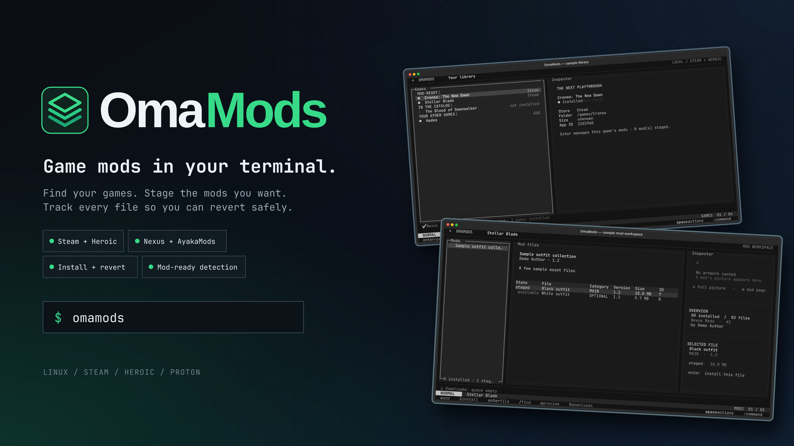

#  OmaMods



OmaMods is a terminal mod manager for Linux game libraries. It discovers Steam
and Heroic games, stages downloads from Nexus Mods and AyakaMods, and installs
supported archive layouts with per-file ownership records so they can be
reverted. It also supports selected GitHub and Codeberg release mods.

The preview uses a test library; it shows no personal games or credentials.
OmaMods is under active development. A game appearing in the library does not
mean its mods can be installed: the screen separates **Mod-ready**, **In the
catalog**, and **Your other games**.

## Get started

Requires Python 3.12 or newer. From this repository:

```sh
python -m venv .venv
source .venv/bin/activate
python -m pip install -e '.[dev]'
omamods
```

Press `K` to save a personal Nexus API key and `n` to register the `nxm://`
handler if you use Nexus' Mod Manager Download button. Choose a mod-ready
game, press `a` to add a mod page, `i` to install staged files, or `u` to
uninstall. Use `:help` for screen-specific commands. `omamods game list` and
`omamods inspect <game-id>` provide read-only discovery from the CLI.

Install `bsdtar` for ZIP, 7z, and RAR archives; some RAR5 files also need `7z`.
Close the game before installing or reverting mods.

## Documentation

Browse the [documentation index](docs/README.md) or start here:

- [Using the terminal UI](docs/using-the-tui.md): keys, queues, downloads, themes, and AyakaMods.
- [Game workflows](docs/game-workflows.md): game-specific install rules and CLI installs.
- [Discovery](docs/discovery.md): Steam inspection and CLI exit codes.
- [Configuration and storage](docs/configuration.md): credentials, archives, records, and backups.
- [Troubleshooting](docs/runbooks/troubleshooting.md): downloads, installs, and recovery.
- [Architecture](docs/architecture.md), [decisions](docs/adr/README.md), [catalog manifest spec](docs/specs/game-manifest.md), and [glossary](docs/glossary.md).
- [Contributing](CONTRIBUTING.md), the [development runbook](docs/runbooks/development.md), [brand assets](docs/branding.md), and [AGENTS.md](AGENTS.md).
- [Security and privileges](SECURITY.md): what OmaMods reads, writes, runs, and sends.
- [Changelog](CHANGELOG.md).

Game-specific notes live under [`games/`](games/). The test command is:

```sh
PYTHONPATH=src .venv/bin/python -m unittest discover -s tests
```
